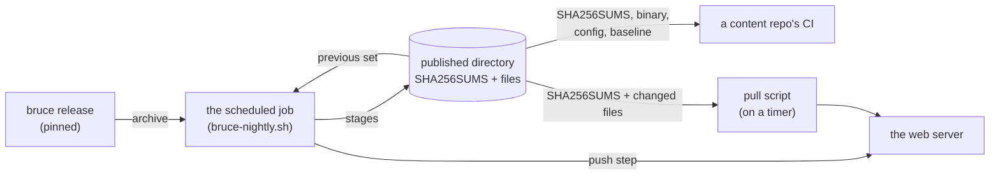
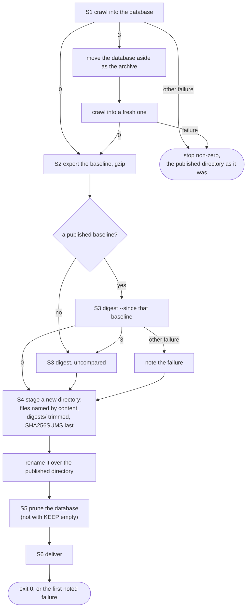
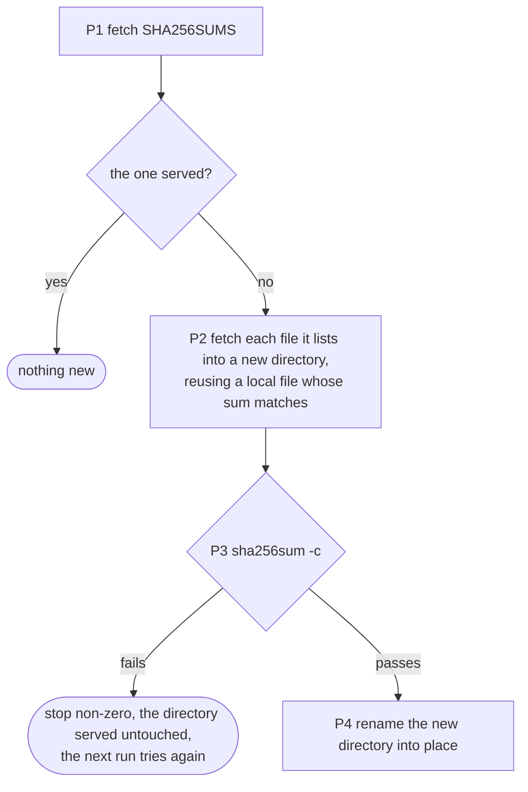
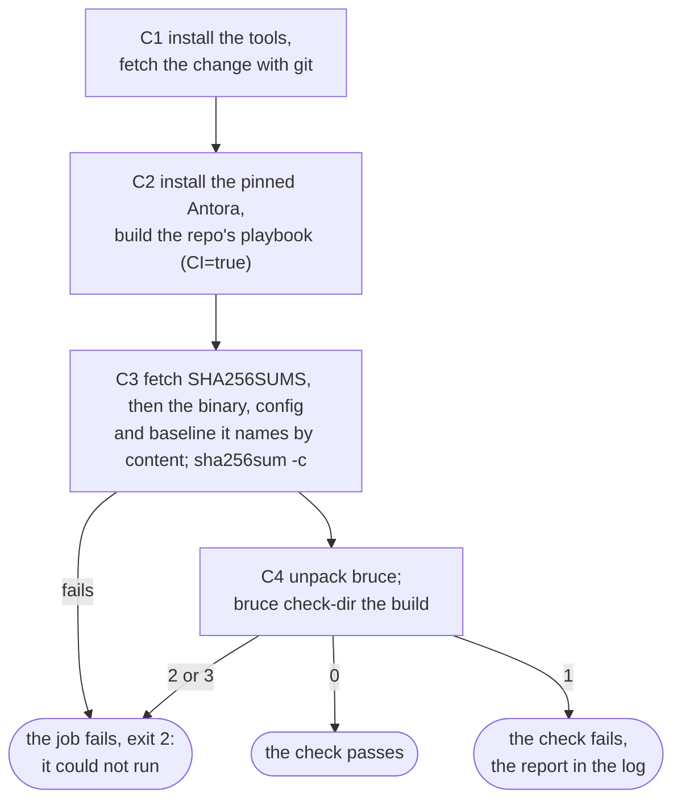

# Deploying `bruce`

A **deployment** is one site's configuration, the scheduled job that runs
`bruce crawl` with it, and wherever its results are kept. `bruce` ships none:
the configuration of a site belongs with whoever runs the crawl. This guide
shows how to write one, using docs.fedoraproject.org as the worked example.
The configuration keys are explained in [`config.md`](config.md), and
`bruce crawl` in [`crawl.md`](crawl.md); this guide says which to write for a
site like this one, and why.

The guide is in three parts: the configuration, which says what is crawled and how,
the scheduled job that crawls with it and publishes the results, which
[starts here](#scheduling-a-crawl), and a content repo's CI job, which checks its
build against what the job publishes, which [starts here](#checking-a-content-repos-build).

The code blocks marked `file=<path>` are the files of the example: this
repository extracts them into a directory and checks that `bruce` accepts the
configuration and the scripts (`mise run sim`), so the example cannot drift from
the tool. Blocks that share a path are one file, in the order they appear here;
a block marked with two paths belongs to both files.

## The configuration

Write the file as `bruce.toml`. Every key is optional but a root's `url`, so
the file below says only what docs.fedoraproject.org needs.

### Who is crawling

```toml file=bruce.toml file=bruce-locales.toml
user_agent = "bruce-fedora-docs/1.0 (+https://docs.fedoraproject.org/)"
```

Every request names the crawler. Replace the address in the parentheses with
one where a site operator can reach whoever runs your crawl. The value up to
its first `/` or space is what a site's `robots.txt` knows the crawler by,
here `bruce-fedora-docs`
([`config.md`](config.md#user-agent)).

### Which links are checked on other hosts

```toml file=bruce.toml file=bruce-locales.toml
allowlist = [
  "fedoraproject.org", "*.fedoraproject.org",
  "getfedora.org", "*.getfedora.org",
  "fedorapeople.org", "*.fedorapeople.org",
  "fedoramagazine.org", "*.fedoramagazine.org",
  "fedorainfracloud.org", "*.fedorainfracloud.org",
  "fedorahosted.org", "*.fedorahosted.org",
  "pagure.io", "*.pagure.io",
  "centos.org", "*.centos.org",
  "redhat.com", "*.redhat.com",
]
```

`allowlist` makes `bruce` fetch each link's target on these hosts once, so its
`#fragment` can be checked, without ever crawling the host. A link to any other
host is recorded and not checked; add a host to the list to check its links
too.

The list is the Fedora and Red Hat sites, since those are the links the docs
answer for: the Fedora forge, which every page links to for its edit and
history links, the wiki, the mailing lists, Bugzilla, the package sources, the
magazine, the retired fedorahosted.org and pagure.io, CentOS and Red Hat's
documentation. The English pages link to about 160 hosts under these domains.
Each domain is written twice, since `"*.fedoraproject.org"` names every host
below `fedoraproject.org`, the forge among them, but not `fedoraproject.org`
itself, the wiki. Naming domains rather than hosts keeps the list current as
hosts come and go.

A `*.` entry never names the host a root starts on, so the site's other
locales on `docs.fedoraproject.org` stay unchecked
([`config.md`](config.md#allowlist)).

A link to a staging or internal host under these domains is then checked like
any other, and reported as what it is to a reader: broken where the page is
missing, an error where the host asks for a login or fails. A host whose name
does not resolve outside Red Hat's network is `broken_url`, and one that
refuses or never answers is an `error`, the reason saying which (`nxdomain`,
`connect`, `timeout`): `bruce` reads a host's `robots.txt` before anything else
on it, and its silence there is the answer for every link to that scheme, host
and port. A
host's `robots.txt` can also forbid a link: Bugzilla's allows only its bug pages, and
fedorapeople.org's allows nothing, so those links are reported as not checked,
with the reason `robots`.

### Which links are never asked about

```toml file=bruce.toml file=bruce-locales.toml
skip = [
  "https://forge.fedoraproject.org/**/issues/new*",
  "https://forge.fedoraproject.org/**/issues/new*/**",
  "https://forge.fedoraproject.org/user/login*",
]
```

Without a login, the forge answers `issues/new` with a redirect to
`/user/login` whether or not the repository exists. Such a link would be
reported as working, so it tells nothing, and every page carries one. A link
matching a `skip` glob is recorded as not checked, with the reason `skipped`,
and no request is sent.

The page's edit link carries its path in the query, as
`issues/new?title=Doc%20issue%20in%20file%20modules/ROOT/pages/index.adoc`,
and `*` stops at a `/`. The first glob matches a link whose query holds none;
the second matches one whose query does, and `issues/new/choose`.

The last glob is the login page itself. A link that redirects to a skipped
URL stops there, so any other link that the forge sends to the login page is
also marked not checked, rather than followed. `*` stops at a `/`, `**` does
not, and the query is part of what is matched ([`config.md`](config.md#skip)).

### How fast each host is asked

```toml file=bruce.toml file=bruce-locales.toml
[host."docs.fedoraproject.org"]
robots = false
per_second = 3

[host."forge.fedoraproject.org"]
per_second = 1
```

docs.fedoraproject.org's `robots.txt` asks crawlers for one second between
requests (`Crawl-delay: 1`) and disallows some paths. Its disallows are
written for search engines, and a crawl of the site's own links is
better without them: they hid nine broken links from live pages, each a 404
for anyone who follows it. So the example turns `robots.txt` off for this host,
which turns its `Crawl-delay` off with it, and writes the rate itself: three
requests a second, the rate settled for this deployment. A rate faster than a
site asked for needs its permission, so ask before copying it for another site.

That is a choice open to whoever may speak for the site, since only a host that
a root starts on may skip its `robots.txt` ([`config.md`](config.md#hosts)). If
you control the site, you can instead add a group to its `robots.txt` for your
crawler's name (here `bruce-fedora-docs`), holding only `Crawl-delay: 1`. A
crawler obeys the most specific group that names it, so the group replaces the
disallows meant for others, and `robots` stays on. For a site you do not
control, leave `robots` on and write no rate: `bruce` obeys its `Crawl-delay`
with no setting at all.

The forge keeps its `robots.txt`: a host that no root starts on is always
obeyed. It asks for one second between requests. Writing that rate keeps
the crawl that polite if its `robots.txt` ever drops the request, since there
the slower of `per_second` and `Crawl-delay` applies.

The other hosts on the allowlist need no section: each is asked at its own
`robots.txt`'s `Crawl-delay`, five seconds for Bugzilla and ten for the mailing
lists and www.redhat.com, and at the default two requests a second where there
is none. They are asked alongside the crawl, each at its own pace.

A crawl of the English pages takes about an hour and a quarter (an hour and
twelve minutes on a GitHub-hosted runner): the forge's
4,100 or so targets at one a second are the longest share, the hosts being asked
alongside one another, so the faster rate on docs.fedoraproject.org shortens
only its own.

### What is crawled

```toml file=bruce.toml
[[root]]
url = "https://docs.fedoraproject.org/en-US/"
sitemap = "https://docs.fedoraproject.org/en-US/sitemap.xml"
```

The root is the English pages: every page whose address begins with the root's
URL is fetched, and every link on it recorded. The site's other locales have
other addresses, so they are not crawled, and the links to them are not
checked; a link to any other address on the site, such as the header's home
link `https://docs.fedoraproject.org/en-US` without its slash, is checked
once.

**The roots set neither `hash_root` nor `hash_exclude`**, so a page of an Antora
site hashes `article.doc`, the profile's content region
([`config.md`](config.md#roots)). A whole-page scope takes in the navigation,
which lists a component's pages, so adding one page would change every page of
its component, and an update of the UI bundle every page of the site.

The sitemap is an index of one sitemap per component. `bruce` would find it
unaided, at `sitemap.xml` under the root; writing it down saves the probe and
shows the next deployer where it is. It is also how `bruce` knows which pages
the site means to publish, as opposed to those it only found by following links.

### How the pages are read

```toml file=bruce.toml file=bruce-locales.toml
[[profile]]
name = "fedora"
extends = "antora"
locale_links = "a.language[href]"
```

docs.fedoraproject.org is built by Antora, which `bruce` reads without any
configuration: the component and version of each page, the content region, the
edit link. What is the site's own is the language menu its build writes on every
page, linking the page under each locale. `locale_links` names those links, and
`bruce` learns from them where the other locales are, so a link to one of their
pages is recorded and left unchecked, as the section above says, and no more than
that. A site with no such menu needs no profile.

The profile `extends = "antora"`, so it does all `antora` does, claims the pages
`antora` claims and records the same facts, `antora.component` among them; the
pages are recorded as read by `fedora`. It is tried before `antora`, and no root
names it ([`config.md`](config.md#profiles)).

## Trying it

With the file saved as `bruce.toml`, a crawl is one command:

```sh
bruce crawl --config bruce.toml --db bruce.duckdb
```

It runs for as long as the hosts' request rates make it. Start a long crawl
detached from your terminal, with its output in a file:

```sh
setsid bruce crawl --config bruce.toml --db bruce.duckdb > crawl.log 2>&1 &
```

and read the log, and the run it wrote, when it has ended
([`crawl.md`](crawl.md#output)).

## Scheduling a crawl

A deployment runs one script on a timer. It crawls, exports the run as the
baseline a content repo's CI checks against ([`export-baseline.md`](export-baseline.md)),
writes the run's digest ([`digest.md`](digest.md)), stages the results as one
directory, and prunes the history. Delivering the directory to wherever it is
served from is a step the deployer writes ([below](#delivering-the-results)).



**A deployment pins the exact `bruce` release its job runs**, and upgrades by
changing the pin, so a schema change reaches it as a commit and not on an
unattended night ([below](#a-schema-change)). Install the release it names where
the job's `PATH` finds `bruce`, and keep its archive beside it, since the job
publishes the archive: a content repo's CI then runs the binary that wrote the
baseline, and the two can never be of different schemas.

```sh
tag=v0.3.0   # the release to pin
base=https://github.com/mwinters0/bruce/releases/download/$tag
archive=bruce-$tag-x86_64-unknown-linux-gnu.tar.gz
install -d /opt/bruce/bin /var/lib/bruce/nightly /var/lib/bruce/locales /etc/bruce
cd /opt/bruce
curl -fsSLO "$base/$archive" -O "$base/$archive.sha256"
sha256sum -c "$archive.sha256"
ln -sf "$archive" release.tar.gz
tar -xzf "$archive" --strip-components=1 -C bin "bruce-$tag-x86_64-unknown-linux-gnu/bruce"
```

### The script

Everything the job needs it takes from its environment, so one script serves
the nightly crawl, the weekly every-locale crawl ([below](#every-locale-weekly))
and a runner with no disk to keep.

| Variable | Default | Meaning |
|---|---|---|
| `ARCHIVE` | required | The pinned release's archive, which the job publishes. |
| `CONFIG` | `bruce.toml` | The configuration the crawl runs under, published beside the baseline. |
| `DB` | `bruce.duckdb` | The history database. |
| `PUB` | `pub` | The published directory as last published, replaced by the job. |
| `KEEP` | `30` | The runs the database keeps (`bruce prune --keep`). Empty keeps no history, and the job does not prune. |
| `NAME` | `bruce` | The digest files' stem, so two jobs' digests can share a directory. |
| `KEEP_VIEWS` | `30` | The nights of digest kept in HTML and every other view. |
| `KEEP_JSON` | `90` | The nights of digest kept as JSON: about three months. |
| `DELIVER` | none | A command run with `PUB` once it is staged ([below](#delivering-the-results)). |

```bash file=bruce-nightly.sh
#!/usr/bin/env bash
# The scheduled job: crawl, export the baseline, write the digest, stage the
# published directory, prune the history, deliver. The variables are the guide's.
set -u
shopt -s nullglob

: "${ARCHIVE:?the archive of the pinned release}"
CONFIG=${CONFIG:-bruce.toml}
DB=${DB:-bruce.duckdb}
PUB=${PUB:-pub}
PUB=${PUB%/}
KEEP=${KEEP-30}
NAME=${NAME:-bruce}
KEEP_VIEWS=${KEEP_VIEWS:-30}
KEEP_JSON=${KEEP_JSON:-90}
DELIVER=${DELIVER:-}

# The first failure's status is the job's, once it has done what it still can.
rc=0
note() { [ "$rc" -ne 0 ] || rc=$1; }

crawl() {
  bruce crawl --config "$CONFIG" --db "$DB"
}

# S1: crawl. A database of another schema (3) is moved aside as the archive,
# replacing the last, and the crawl starts a fresh one. Any other failure stops
# the job with the published directory as it was.
crawl
status=$?
if [ "$status" -eq 3 ]; then
  echo "bruce-nightly: $DB is of another schema version; moved aside as $DB.archive" >&2
  mv -f "$DB" "$DB.archive"
  if [ -e "$DB.wal" ]; then mv -f "$DB.wal" "$DB.archive.wal"; fi
  crawl
  status=$?
fi
[ "$status" -eq 0 ] || exit "$status"

work=$(mktemp -d "$PUB.work.XXXXXX") || exit 1
new=$PUB.new
trap 'rm -rf "$work" "$new"' EXIT
mkdir "$work/digest"

# S2: the run as the baseline, gzipped.
bruce export-baseline --db "$DB" --out "$work/baseline.duckdb" || exit
gzip -n -9 "$work/baseline.duckdb" || exit 1

# S3: the digest, compared with the baseline this job replaces. With none, or
# with one of another schema (3), it is written uncompared. A digest that
# still fails does not stop the job: CI needs the baseline.
digest=3
if [ -f "$PUB/baseline.duckdb.gz" ]; then
  bruce report digest --db "$DB" --out "$work/digest" --name "$NAME" --since "$PUB/baseline.duckdb.gz"
  digest=$?
fi
if [ "$digest" -eq 3 ]; then
  rm -f "$work/digest"/*
  bruce report digest --db "$DB" --out "$work/digest" --name "$NAME"
  digest=$?
fi
[ "$digest" -eq 0 ] || note "$digest"

# Deletes the files given that are dated before the $1 newest nights among them.
trim() {
  local keep=$1 cutoff f d
  shift
  cutoff=$(for f in "$@"; do d=${f##*/}; d=${d#"$NAME"-}; echo "${d:0:10}"; done | sort -ru | sed -n "${keep}p")
  [ -n "$cutoff" ] || return 0
  for f in "$@"; do
    d=${f##*/}; d=${d#"$NAME"-}
    if [[ ${d:0:10} < $cutoff ]]; then rm -f "$f"; fi
  done
}

short() { sha256sum "$1" | cut -c1-16; }

# S4: stage a new directory, then rename it over PUB. SHA256SUMS is written
# last; the files it lists are named by their content.
stage() {
  set -e
  rm -rf "$new"
  mkdir -p "$new/digests"
  cp "$ARCHIVE" "$new/bruce.tar.gz"
  cp "$CONFIG" "$new/bruce.toml"
  cp "$work/baseline.duckdb.gz" "$new/baseline.duckdb.gz"
  local bin=bruce-$(short "$new/bruce.tar.gz").tar.gz
  local cfg=config-$(short "$new/bruce.toml").toml
  local base=baseline-$(short "$new/baseline.duckdb.gz").duckdb.gz
  cp "$new/bruce.tar.gz" "$new/$bin"
  cp "$new/bruce.toml" "$new/$cfg"
  cp "$new/baseline.duckdb.gz" "$new/$base"

  # Last night's set stays one more night, for a fetcher given a stale
  # SHA256SUMS by a cache in front of the directory.
  if [ -f "$PUB/SHA256SUMS" ]; then
    local sum name
    while read -r sum name; do
      case $name in
        bruce-*.tar.gz|config-*.toml|baseline-*.duckdb.gz) cp -p "$PUB/$name" "$new/" || true ;;
      esac
    done < "$PUB/SHA256SUMS"
  fi

  # The dated digests are carried over and tonight's added, under the counts.
  if [ -d "$PUB/digests" ]; then cp -Rp "$PUB/digests/." "$new/digests/"; fi
  local f rest
  if [ "$digest" -eq 0 ]; then
    for f in "$work/digest"/*; do
      cp "$f" "$new/digests/"
      rest=${f##*/}
      rest=${rest#"$NAME"-????-??-??}
      cp "$f" "$new/digest$rest"
    done
  else
    for f in "$PUB"/digest.* "$PUB"/digest-*; do cp -p "$f" "$new/"; done
  fi
  local json=("$new/digests/$NAME"-????-??-??.json) views=()
  for f in "$new/digests/$NAME"-????-??-??[.-]*; do
    case $f in *.json) ;; *) views+=("$f") ;; esac
  done
  trim "$KEEP_JSON" "${json[@]}"
  trim "$KEEP_VIEWS" "${views[@]}"

  (cd "$new" && sha256sum "$bin" "$cfg" "$base" digest.* digest-* digests/*) > "$work/SHA256SUMS"
  cp "$work/SHA256SUMS" "$new/SHA256SUMS"

  rm -rf "$PUB.old"
  if [ -e "$PUB" ]; then mv "$PUB" "$PUB.old"; fi
  mv "$new" "$PUB"
  rm -rf "$PUB.old"
}
( stage )
staged=$?
if [ "$staged" -ne 0 ]; then
  echo "bruce-nightly: staging failed; $PUB is as it was" >&2
  note "$staged"
fi

# S5: prune the history. Staging is done, so a failure here costs no publication.
if [ -n "$KEEP" ]; then
  bruce prune --db "$DB" --keep "$KEEP" || note $?
fi

# S6: deliver.
if [ -n "$DELIVER" ] && [ "$staged" -eq 0 ]; then
  "$DELIVER" "$PUB" || note $?
fi
exit "$rc"
```

What each step does, and what a failure at it leaves:

- **S1, crawl.** The crawl is the job's one long step. It exits 3 where the
  database is of another schema ([below](#a-schema-change)); any other failure
  stops the job, non-zero, before anything is published.
- **S2, export.** The run becomes the baseline, gzipped; `check-dir` reads a
  `.gz` path or URL as it reads the file.
- **S3, digest.** The digest compares with the baseline the job is about to
  replace, so it says what changed since the baseline CI last judged by, and a
  night that failed to publish is folded into the next. It needs no earlier
  run in the database, so a deployment that keeps no history (`KEEP=`) has the
  same digest as one that does. With no baseline yet, or one of another schema
  version, the digest is written without a comparison. A digest that fails for
  any other cause does not stop the job: the baseline CI needs is still
  published, the digest's files stay as they were, and the job ends non-zero.
- **S4, stage.** The new directory is built beside `PUB` and renamed over it, so
  the files `SHA256SUMS` lists are in place before it is, and a failure while
  staging leaves `PUB` as it was ([the directory](#the-published-directory)).
- **S5, prune.** After the files are staged, so a database that cannot be pruned
  costs no publication; it must not run beside a crawl, which the one script
  ensures ([`prune.md`](prune.md#not-beside-a-crawl)).
- **S6, deliver.** `DELIVER` is run with the directory's path. It is skipped
  after a staging failure, since `PUB` then holds the last night's set.



### Scheduling it

A timer runs the script as a systemd service on Fedora. One service template
serves both crawls, `%i` naming the instance, `nightly` or `locales`, which
picks its environment file and its working directory.

```ini file=systemd/bruce-crawl@.service
[Unit]
Description=bruce: the %i crawl
After=network-online.target
Wants=network-online.target

[Service]
Type=oneshot
User=bruce
Environment=PATH=/opt/bruce/bin:/usr/local/bin:/usr/bin
EnvironmentFile=/etc/bruce/%i.env
WorkingDirectory=/var/lib/bruce/%i
ExecStart=/usr/local/libexec/bruce/bruce-nightly.sh
TimeoutStartSec=infinity
```

```ini file=systemd/bruce-nightly.timer
[Unit]
Description=bruce: the nightly en-US crawl

[Timer]
OnCalendar=*-*-* 01:00:00 UTC
Persistent=true
Unit=bruce-crawl@nightly.service

[Install]
WantedBy=timers.target
```

```sh file=etc/bruce/nightly.env
ARCHIVE=/opt/bruce/release.tar.gz
CONFIG=/etc/bruce/bruce.toml
DB=/var/lib/bruce/nightly/bruce.duckdb
PUB=/var/lib/bruce/nightly/pub
KEEP=30
```

Install the script (`install -m 0755 bruce-nightly.sh /usr/local/libexec/bruce/`)
and the configuration, create the `bruce` user, and `systemctl enable --now
bruce-nightly.timer`. `Persistent=true` runs a night the machine slept through
when it wakes. Where systemd is not at hand, the same job is one line of
`cron`, the environment on it:

```sh
0 1 * * *  ARCHIVE=/opt/bruce/release.tar.gz CONFIG=bruce.toml PUB=/srv/bruce/pub /usr/local/libexec/bruce/bruce-nightly.sh
```

### Every locale, weekly

docs.fedoraproject.org has 69 locales, each carrying en-US's pages, so a crawl
of every locale is about 69 times the requests of en-US's: some 220,000 to
docs.fedoraproject.org alone, which at three a second is about 20 hours. So the
deployment runs **two crawls into two databases**: the English pages nightly,
the run CI's baseline is exported from, and every locale weekly, in a database
of its own. DuckDB lets one process write a file, so a long crawl never holds
the nightly one's. CI's baseline stays en-US's.

The weekly crawl's configuration is `bruce.toml` with one root, at the site's
top, in place of en-US's:

```toml file=bruce-locales.toml
[[root]]
url = "https://docs.fedoraproject.org/"
sitemap = "https://docs.fedoraproject.org/en-US/sitemap.xml"
```

The sitemap is en-US's: every locale's `sitemap.xml` repeats it, and no locale's
pages are in one, so the other locales are found by the language menu's links
([How the pages are read](#how-the-pages-are-read)). A locale added later is
crawled unasked, and so is the occasional first path segment that is no locale
(`infra`, `f28`), where en-US's configuration asks each once.

```sh file=etc/bruce/locales.env
ARCHIVE=/opt/bruce/release.tar.gz
CONFIG=/etc/bruce/bruce-locales.toml
DB=/var/lib/bruce/locales/bruce.duckdb
PUB=/var/lib/bruce/locales/pub
NAME=bruce-locales
KEEP=8
```

```ini file=systemd/bruce-weekly.timer
[Unit]
Description=bruce: the weekly every-locale crawl

[Timer]
OnCalendar=Sat *-*-* 00:00:00 UTC
Persistent=true
Unit=bruce-crawl@locales.service

[Install]
WantedBy=timers.target
```

The weekly database keeps eight runs, two months. Its results stay where the
job ran: they are published as a second directory only once the size of the
every-locale digest is known, and CI never reads them.

## The published directory

The job ends by staging **one directory**, and what it holds is the contract
between the job, a content repo's CI and whatever serves the results:

| File | For | Holds |
|---|---|---|
| `SHA256SUMS` | fetchers | `sha256sum`'s format, written last: the three files below, the latest digest and `digests/`. |
| `bruce-<sha>.tar.gz`, `config-<sha>.toml`, `baseline-<sha>.duckdb.gz` | CI and pullers | The pinned release's archive, the configuration and the baseline, each named by the first 16 hex digits of its own sha256. Last night's three stay one more night. |
| `bruce.tar.gz`, `bruce.toml`, `baseline.duckdb.gz` | people | The same files under fixed names, always the latest. |
| `digest.json`, `digest.html` | people, pullers | The latest digest, in the JSON and every view the job writes (`digest-<view>` for a view in a file `<view>`). |
| `digests/` | people, pullers | The dated digests: `bruce-YYYY-MM-DD.json`, `.html` and the rest. |

**A fetcher fetches `SHA256SUMS` first, then the files it lists, and runs
`sha256sum -c`** (`--ignore-missing` where it fetched only some), failing as
could-not-run, never as broken links. The names are why: a directory served
through a cache can answer `SHA256SUMS` from before the last deploy and a file
from after it. GitHub Pages serves each file with `Cache-Control: max-age=600`,
file by file. CI, handed a stale `SHA256SUMS`, finds last night's three files,
which stay, and handed a fresh one asks for names no cache holds. A puller, which
takes the digests too, can instead fail its check and retry
([below](#delivering-the-results)). The
sums say nothing of the release or the schema: the binary and the baseline of
one night are listed together, and the digest's JSON says which `bruce` crawled.

A reader of the directory knows there is something new when `SHA256SUMS` has
changed.

### What grows, and what bounds it

Everything that accretes is bounded by a count, so a deployment runs for years
unattended:

- **The history database**, by `bruce prune --keep` after every night: 30 runs
  of the English pages are 0.7 to 0.85 GB, and a database pruned nightly holds
  a steady size once it holds the thirty (`prune` returns almost nothing to the
  file, and DuckDB reuses the freed blocks).
- **The dated digests**, by `KEEP_VIEWS` and `KEEP_JSON`: 30 nights of HTML and
  of any other view, and 90 nights of JSON, the report a loader keeps
  ([`digest.md`](digest.md)). An en-US night adds about 10 MB of HTML and 5.4 MB
  of JSON, so at the defaults, with two nights of binary and baseline, the
  directory is some 850 MB, inside GitHub Pages' 1 GB. A directory outgrowing
  its host keeps fewer nights; one on a disk may keep more JSON.
- **The archive of a database of another schema**, one, replaced by the next.

### A schema change

`bruce` migrates no database ([`crawl.md`](crawl.md)): runs are never changed,
and a migrated one would lack what its crawl never collected, so a view judging
it would judge on missing facts. Every command that opens a database or a
baseline exits 3 on one of another schema version, and the script answers that
status alone: the crawl moves the database aside as `bruce.duckdb.archive`
(replacing the last archive) and starts a fresh one, and the digest is written
without a comparison. The new binary and the new baseline are published in one
set, which a content repo's next fetch takes whole. Delete the archive when it
is no longer wanted.

## Delivering the results

Some deployments push the results when the job ends; others serve them from a
host that fetches them. The script stops at the staged directory and the guide
shows both.

**A push** is a command the deployment writes, named in `DELIVER` and run with
the directory's path. `rsync` to a web server:

```bash file=deliver-rsync.sh
#!/usr/bin/env bash
# DELIVER: copy the staged directory to $TARGET, SHA256SUMS last, and delete
# what the new set no longer holds only after it is whole.
set -eu
rsync -a --delete-after --exclude SHA256SUMS "$1/" "${TARGET:?}/"
rsync -a "$1/SHA256SUMS" "${TARGET:?}/"
```

**A pull** is for a server that cannot be pushed to, or that is rebuilt from
somewhere else. A timer on it runs this script, which fetches `SHA256SUMS` from
the published URL and, where it changed, every file it lists, reusing a local
file whose sum matches, checks them all, and renames the new directory into
place. A set that fails its check is dropped, the directory served stays as it
was, and the next run tries again.

```bash file=bruce-pull.sh
#!/usr/bin/env bash
# Pull the published directory at $URL into $DEST, replacing $DEST as a whole.
set -u
URL=${URL:?the address of the published directory}
URL=${URL%/}
DEST=${DEST:?the directory served from}
DEST=${DEST%/}

tmp=$(mktemp -d "$DEST.pull.XXXXXX") || exit 1
trap 'rm -rf "$tmp"' EXIT

# P1: nothing new when SHA256SUMS is the one served.
curl -fsS --retry 3 -o "$tmp/SHA256SUMS" "$URL/SHA256SUMS" || exit 1
if cmp -s "$tmp/SHA256SUMS" "$DEST/SHA256SUMS"; then exit 0; fi

# P2: every file it lists, from here where the sum matches, else from the URL.
mkdir "$tmp/new"
while read -r sum name; do
  name=${name#\*}
  case /$name/ in
    //*|*/../*) echo "bruce-pull: $name is not inside the directory" >&2; exit 1 ;;
  esac
  mkdir -p "$tmp/new/$(dirname "$name")"
  if [ -f "$DEST/$name" ] && [ "$(sha256sum < "$DEST/$name" | cut -d' ' -f1)" = "$sum" ]; then
    cp -p "$DEST/$name" "$tmp/new/$name"
  else
    curl -fsS --retry 3 -o "$tmp/new/$name" "$URL/$name" || exit 1
  fi
done < "$tmp/SHA256SUMS"
cp "$tmp/SHA256SUMS" "$tmp/new/SHA256SUMS"

# P3: all of it, or none.
(cd "$tmp/new" && sha256sum -c --quiet SHA256SUMS) || { echo "bruce-pull: the set fails its sums" >&2; exit 1; }

# P4: into place.
if [ -e "$DEST" ]; then mv "$DEST" "$tmp/old"; fi
mv "$tmp/new" "$DEST"
```



A pull run while the set is being deployed may find `SHA256SUMS` and a file it
lists from different nights: its check fails, and a run after the cache expires
passes. CI never meets this, fetching only the files named by content.

**`DEST` must persist from one run to the next, and nothing else may rewrite
it.** The script knows there is nothing new by the `SHA256SUMS` there, reuses
the files there whose sums match, and leaves what is there served when a run
fails. Rebuilt empty for every run, it fetches the whole set each time, and a
failed run leaves nothing to serve. A site whose pages are copied from a build
by `rsync --delete`, as docs.fedoraproject.org's proxies are, pulls into a
directory the build keeps, which is for the site's operators to choose. On
docs.fedoraproject.org that is a top-level directory of the build's output
volume, never one inside a language's tree, which every build replaces.

## Checking a content repo's build

A content repo's CI job builds the repo's pages, takes the binary, the
configuration and the baseline from the published directory, and runs `bruce
check-dir` on the build ([`check-dir.md`](check-dir.md)): the pull request fails
on a link the change broke, and on no link that was already broken. The workflow
below runs on Forgejo Actions, which the Fedora forge runs, and on GitHub
Actions. It uses no action: every step is a command in the job's container, so
nothing in it is another project's to change, and `mise run sim` fails the
example on a `uses:`.



```yaml file=.github/workflows/links.yml
name: links

on:
  pull_request:

permissions:
  contents: read

jobs:
  links:
    runs-on: ubuntu-latest
    container: registry.fedoraproject.org/fedora-minimal:44
    env:
      PUB_URL: https://example.org/bruce
      PREFIX: https://docs.fedoraproject.org/en-US/
      PLAYBOOK: site.yml
      SITE_DIR: public
      ANTORA_VERSION: 3.1.15
      ANTORA_DIR: /opt/antora
    steps:
      - name: Install the tools
        run: |
          microdnf -y install --setopt=install_weak_deps=False nodejs-npm git tar gzip

      - name: Check out the change
        run: |
          git config --global --add safe.directory "$GITHUB_WORKSPACE"
          git init -q .
          git fetch -q --depth 1 "$GITHUB_SERVER_URL/$GITHUB_REPOSITORY" "$GITHUB_SHA"
          git checkout -q FETCH_HEAD

      - name: Install Antora
        run: |
          npm install --no-audit --no-fund --prefix "$ANTORA_DIR" \
            "@antora/cli@$ANTORA_VERSION" "@antora/site-generator@$ANTORA_VERSION"

      - name: Build the site
        run: |
          CI=true "$ANTORA_DIR/node_modules/.bin/antora" --html-url-extension-style=indexify "$PLAYBOOK"

      - name: Fetch what the deployment published
        run: |
          fail() {
            echo "bruce: $1; the job could not run, which says nothing of the change" >&2
            exit 2
          }
          mkdir bruce-ci
          cd bruce-ci
          curl -fsS --retry 3 -o SHA256SUMS "$PUB_URL/SHA256SUMS" || fail "no SHA256SUMS at $PUB_URL"
          # The one file of a kind that SHA256SUMS lists, named by its content.
          pick() {
            found=$(grep -E "^[0-9a-f]{64} [ *]$1\$" SHA256SUMS | cut -c67-)
            [ -n "$found" ] && [ "$(echo "$found" | wc -l)" -eq 1 ] || fail "SHA256SUMS lists no single $1"
            echo "$found"
          }
          archive=$(pick 'bruce-[0-9a-f]{16}\.tar\.gz')
          config=$(pick 'config-[0-9a-f]{16}\.toml')
          baseline=$(pick 'baseline-[0-9a-f]{16}\.duckdb\.gz')
          for name in "$archive" "$config" "$baseline"; do
            curl -fsS --retry 3 -O "$PUB_URL/$name" || fail "cannot fetch $name"
          done
          sha256sum -c --quiet --ignore-missing SHA256SUMS || fail "a file fails its sum in SHA256SUMS"
          mv "$config" bruce.toml
          mv "$baseline" baseline.duckdb.gz
          mkdir bin
          tar -xzf "$archive" --strip-components=1 -C bin

      - name: Check the build
        run: |
          export PATH="$GITHUB_WORKSPACE/bruce-ci/bin:$PATH"
          bruce check-dir "$SITE_DIR" --prefix "$PREFIX" \
            --baseline bruce-ci/baseline.duckdb.gz --config bruce-ci/bruce.toml \
            --db bruce-ci/ci.duckdb && status=0 || status=$?
          case $status in
            0) echo "This change breaks no link." ;;
            1) echo "This change breaks the links listed above." >&2; exit 1 ;;
            *) echo "bruce could not check the build (exit $status): the job failed, not the change" >&2; exit "$status" ;;
          esac
```

Put the file at `.github/workflows/links.yml`, which both forges read. Five
settings are the deployment's, in the job's `env`:

- **`PUB_URL`** is the address of the published directory, where `SHA256SUMS`
  is ([above](#the-published-directory)).
- **`PREFIX`** is the production address of the build's root, which must be
  inside a root of the configuration ([`check-dir.md`](check-dir.md)).
- **`PLAYBOOK` and `SITE_DIR`** are the repo's Antora playbook and the
  directory it writes the site to: `site.yml` and `public` for a repo following
  Fedora's docs template.
- **`ANTORA_VERSION`** is the Antora to build with, pinned, so the build does
  not change under a pull request. Production's image installs `@antora/cli@3.1`,
  the newest 3.1, which on 2026-11-03 is 3.1.15. Raise the pin in a commit when
  production's moves; the pages `bruce` reads are the same across 3.1.

Where the example says `ubuntu-latest`, the Fedora forge's runners are labelled
`podman`. They cap a job at ten minutes. Installing the tools and Antora takes
half a minute, and the check took 9 seconds over quick-docs' 236 pages; the build
is the repo's own. The installs can be baked into an image to save the half
minute.

What each step does, and what a failure at it means:

- **C1, the tools and the change.** The job starts from Fedora's latest
  container, 44, not from the docs site's own image, which is Fedora 42, past
  its end of life. The change is fetched by its commit with `git`, a public
  repository needing no credential; a private one needs it added to that
  command. A fetch made this way has no `origin`, so the build writes no edit
  link.
- **C2, the build.** `CI=true` drops the link to a local file the Fedora UI
  otherwise writes. The repo's playbook may name other repositories, which
  Antora fetches, so the build needs the network, as the check does: a link on
  the site that the baseline lacks is asked of the live site.
- **C3, the fetch.** `SHA256SUMS` first, then the one binary, configuration and
  baseline it names by content, then `sha256sum -c`. A file that cannot be
  fetched or fails its sum fails the job with status 2: a cache in front of the
  directory can answer `SHA256SUMS` from before the last deploy, and the names
  are why the files it lists are still there ([the directory](#the-published-directory)).
  The binary and the baseline are of one night, so they are of one schema.
- **C4, the check.** `bruce check-dir` runs the binary that crawled the
  baseline, under the configuration it crawled with. The release binary links
  only glibc, 2.41 or older, so it runs on Fedora 44.
- **C5, the exit status.** 0 passes the check. 1 fails it: the log holds the
  report ([`check-dir.md`](check-dir.md#output)). 2 or 3 (`bruce` could not
  run, or the baseline is of another schema) fails the job with a message that
  says the job failed and not the change; a forge cannot show a status in a
  colour of its own, so the message is the difference.
